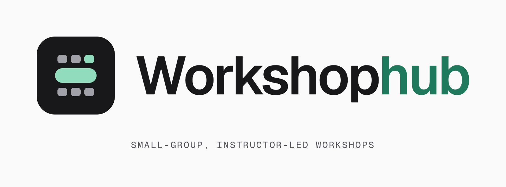
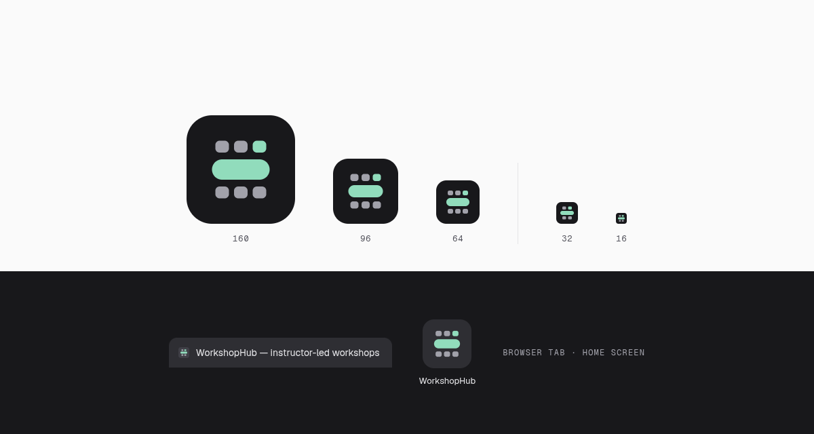

<p align="center">
  
</p>

<p align="center">
  Book small-group, instructor-led workshops. Browse the catalog, pay at a demo checkout,<br />
  unlock course materials and quizzes, and manage everything from an admin console.
</p>

<p align="center">
  
  
  
  
</p>

---

WorkshopHub is a workshop registration system built as the LP-II mini project (TE, Semester 6). It has a React front end and an Express + MongoDB API with JWT authentication.

## Features

**For students**

- **Catalog:** search by title, instructor or topic, filter by discipline, and see live seat availability on every card.
- **Workshop pages:** schedule, skills covered, instructor, attendee list, and a sticky booking panel.
- **Checkout:** a simulated card payment with live card preview and inline validation. Nothing is charged.
- **Confirmation:** a booking ticket with IDs, a PDF receipt, and a direct link back to the workshop.
- **My bookings:** filter confirmed and cancelled bookings, download receipts, and cancel to release a seat.
- **Materials and quizzes:** reading, videos and multiple-choice quizzes unlock once you've booked. Quizzes are timed, show an explanation after each answer, end with a review screen, and support the keyboard (A–D to choose, Enter to continue).

**For admins** (`/admin`)

- **Overview:** headline numbers, seat fill per workshop, and a feed of recent bookings.
- **Workshops:** create, edit and delete sessions. Seat counts are recalculated from existing bookings.
- **Users:** search, filter by role, promote or demote, and delete accounts. You can't change your own account.
- **Registrations:** filter by status, search, see revenue from confirmed bookings only, and export to CSV.

## Tech stack

| Layer    | Tools                                                                          |
| -------- | ------------------------------------------------------------------------------ |
| Frontend | React 18, TypeScript, React Router 7, Tailwind CSS 4, Radix UI, Motion, Sonner |
| Extras   | jsPDF (PDF receipts), canvas-confetti                                          |
| Backend  | Node.js, Express 4, MongoDB driver 7, JWT, bcrypt, Joi, express-rate-limit     |
| Tooling  | Vite 6, deployed on Vercel                                                     |

## Getting started

### Prerequisites

- Node.js 20 or newer
- A MongoDB database (local `mongod` or a free MongoDB Atlas cluster)

### 1. Install

```bash
git clone https://github.com/spongebob2005/Workshop-Registration-System.git
cd Workshop-Registration-System
npm install
```

### 2. Configure

Create a `.env` file in the project root:

```env
# API server
PORT=4000
MONGODB_URI=mongodb+srv://<user>:<password>@<cluster>/workshophub?retryWrites=true&w=majority
MONGODB_DB=workshophub
JWT_SECRET=change-me-to-a-long-random-string
ALLOWED_ORIGINS=http://localhost:5173

# Seeded on first start if no admin exists
DEFAULT_ADMIN_EMAIL=<admin-email>
DEFAULT_ADMIN_PASSWORD=<strong-password>
```

The frontend calls `/api` on its own origin. In dev, Vite proxies `/api` to `http://localhost:4000`; set `VITE_API_BASE_URL` only if the API lives somewhere else.

`.env` files are git-ignored. Never commit real credentials.

### 3. Run

Start the API and the frontend in two terminals:

```bash
npm run dev:server   # Express API on http://localhost:4000
npm run dev          # Vite dev server on http://localhost:5173
```

If the `workshops` collection is empty, the catalog shows eight sample workshops, and they are saved to the database the first time an admin loads the app (seeding needs an admin token). Sign in with the admin credentials you set above, or register a new student account.

### Try a booking

1. Register, open any workshop, and choose **Book a seat**.
2. At checkout, enter any name, any 16-digit card number (e.g. `4242 4242 4242 4242`), a future expiry such as `12/28`, and any 3-digit CVV.
3. Download the receipt, then open the workshop's **Materials** tab to start a quiz.

## Scripts

| Command                | What it does                       |
| ---------------------- | ---------------------------------- |
| `npm run dev`        | Start the Vite dev server          |
| `npm run dev:server` | Start the Express API              |
| `npm run build`      | Production build into `dist/`    |
| `npm run preview`    | Serve the production build locally |

## API

All routes are prefixed with `/api`. 🔒 marks routes that need an admin JWT (`Authorization: Bearer <token>`).

| Method     | Route               | Purpose                                      |
| ---------- | ------------------- | -------------------------------------------- |
| `GET`    | `/health`         | Health check                                 |
| `POST`   | `/login`          | Sign in, returns `{ user, token }`         |
| `POST`   | `/users`          | Register a student                           |
| `GET`    | `/users`          | 🔒 List users (passwords stripped)           |
| `PUT`    | `/users/:email`   | 🔒 Update a user (e.g. role)                 |
| `DELETE` | `/users/:email`   | 🔒 Delete a user                             |
| `GET`    | `/workshops`      | List workshops                               |
| `POST`   | `/workshops`      | 🔒 Create a workshop                         |
| `PUT`    | `/workshops/:id`  | 🔒 Update a workshop                         |
| `DELETE` | `/workshops/:id`  | 🔒 Delete a workshop                         |
| `POST`   | `/workshops/init` | 🔒 Seed workshops if the collection is empty |
| `GET`    | `/bookings`       | List bookings                                |
| `POST`   | `/bookings`       | Create or update a booking (adjusts seats)   |
| `DELETE` | `/bookings/:id`   | 🔒 Delete a booking                          |
| `GET`    | `/payments`       | List payment records                         |
| `POST`   | `/payments`       | Record a (simulated) payment                 |
| `GET`    | `/admin/stats`    | 🔒 Totals for the admin overview             |
| `GET`    | `/events`         | Activity log (bookings, payments, etc.)      |

MongoDB collections (`users`, `workshops`, `bookings`, `payments`, `events`) are created automatically.

## Project structure

```
.
├── .github/assets/        Logo and brand files used by this README
├── public/                Favicon and app icons (copied into the build as-is)
├── api/
│   └── index.js           Vercel Function entry, serves the Express app at /api/*
├── server/
│   ├── app.js             Express API, auth, MongoDB access
│   └── index.js           Local dev server (npm run dev:server)
├── src/
│   ├── app/
│   │   ├── api/           Fetch wrapper that attaches the JWT
│   │   ├── components/    Navbar, cards, shared page and admin UI, ui/ primitives
│   │   ├── contexts/      Auth and workshop/booking state
│   │   ├── lib/           PDF receipt generator
│   │   ├── pages/         Student pages and admin/ console
│   │   └── routes.tsx     Route table and layouts
│   └── styles/            Tailwind theme: zinc neutrals, pine accent, Geist
├── index.html
└── vercel.json            Build settings, /api and SPA rewrites
```

<p align="center">
  
</p>

## Deployment

Frontend and API deploy together to Vercel. The Vite build is served from `dist`, and `api/index.js` runs the Express app as a Vercel Function for every `/api/*` request (see `vercel.json`).

1. Add `MONGODB_URI`, `MONGODB_DB`, `JWT_SECRET` and, optionally, `DEFAULT_ADMIN_EMAIL` / `DEFAULT_ADMIN_PASSWORD` to the Vercel project (`vercel env add`).
2. In MongoDB Atlas, open **Network Access** and allow `0.0.0.0/0`, because Vercel Functions don't have fixed IPs.
3. Run `vercel deploy --prod`.

## Limitations

- Payments are simulated. No payment provider is involved and no card data leaves the browser.
- Quiz questions are a shared sample set; per-workshop question banks aren't modelled yet.
- `GET /bookings`, `GET /payments` and `GET /events` are public so the catalog can show attendee lists; lock them down before using real data.

## License

MIT
